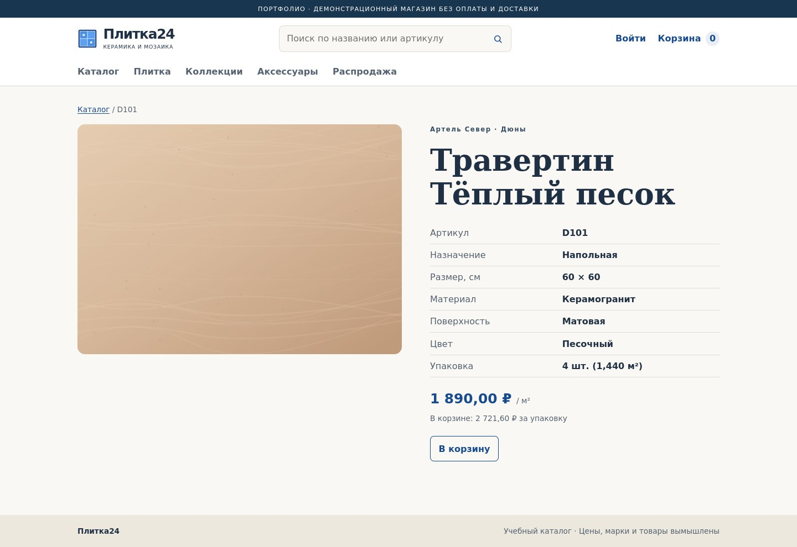
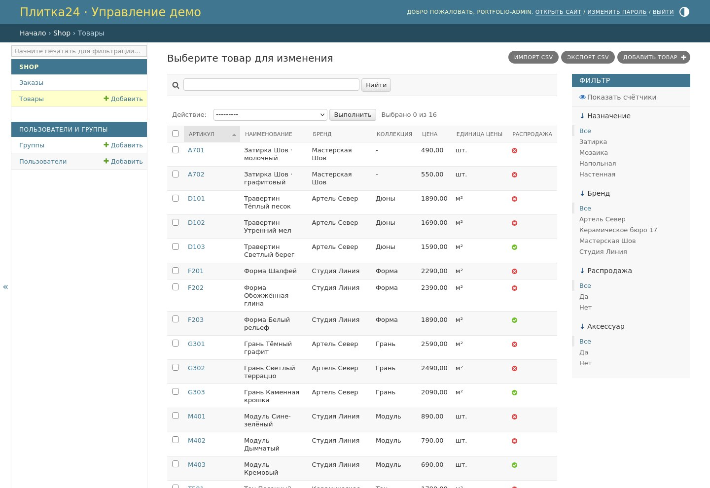

# Plitka24 · Плитка24

A Dockerized portfolio demo of a ceramic tile storefront. It preserves the original branding but runs independently, with an entirely fictional catalog and no production services.


| Product detail | Catalog admin |
| --- | --- |
| [](docs/screenshots/product.jpg) | [](docs/screenshots/admin.jpg) |

[Mobile storefront screenshot](docs/screenshots/mobile.jpg)

## Run the demo

With Docker and the Compose plugin installed, run this from the repository root:

```sh
docker compose up --build
```

Open **http://localhost:8000**. The first start applies migrations and adds 16 fictional items. No `.env` file, credentials, or external database are needed. If port 8000 is occupied, run `PLITKA24_PORT=8080 docker compose up --build` instead.

Try searching for `D101` or `шалфей`, filtering by collection, and adding a tile to the cart. Register with a fictional username to place a demo order and see it in **Профиль → История заказов**. No payment, delivery, or email is triggered.

### Admin and sample CSV

In a second terminal, create your own local admin account (there is no default password):

```sh
docker compose exec web python manage.py createsuperuser
```

Open **http://localhost:8000/admin/** to edit products, update order status, and import or export products. Use [`examples/products.csv`](examples/products.csv) as an import sample. Imports validate the whole file before writing and update matching articles rather than duplicating them.

`docker compose down` stops the demo and preserves the catalog and orders. `docker compose down --volumes` **deletes all local demo data**. A restart adds any missing demo products but does not overwrite existing ones.

## Implementation

- **Django 5.2 LTS and SQLite** for the catalog, session cart, accounts, and orders. Order lines retain the product name and price from checkout even if the catalog changes.
- **Django templates and plain JavaScript** for the Russian storefront. Add-to-cart uses AJAX when available and works as a regular form without JavaScript.
- **Gunicorn and WhiteNoise** in a non-root container. The service binds to loopback by default; this is a local showcase, not a production checkout deployment.
- **Original demo illustrations** are local SVGs. Regenerate the product swatches with `python3 scripts/generate_swatches.py`. See [third-party notices](THIRD_PARTY_NOTICES.md) for dependencies.

## Verify

```sh
docker compose build
docker compose run --rm --no-deps web python manage.py test
docker compose run --rm --no-deps web python manage.py makemigrations --check --dry-run
```

Tests use a separate in-memory database. CI also scans the repository history for secrets, builds and starts the container, and smoke-tests the storefront, static files, and admin login.
